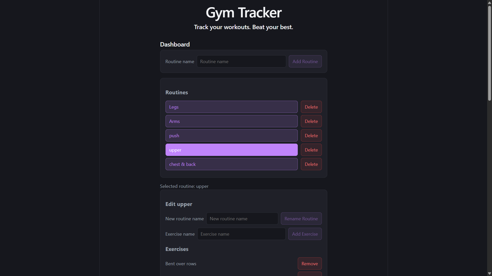
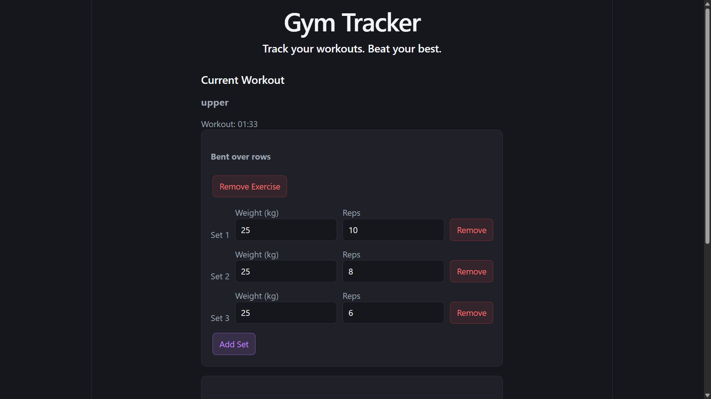
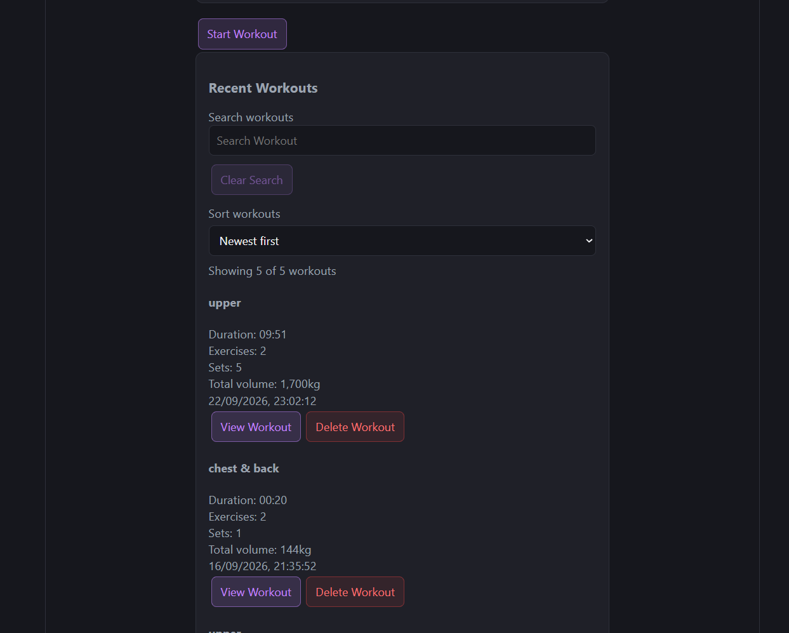
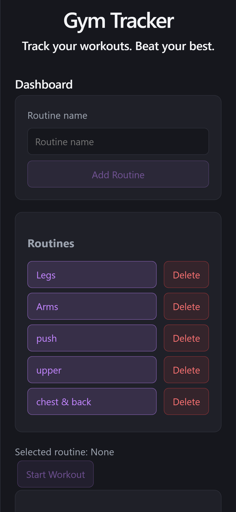

# Gym Tracker

[](https://github.com/zireael06/gym-tracker/actions/workflows/ci.yml)

A responsive React application for creating workout routines, recording sets, and reviewing workout history.

I built this project to practise React state management, component design, form handling, array methods, browser storage, validation, automated testing, and responsive CSS.

## Live Demo

[Open the live Gym Tracker](https://gym-tracker-omega-one.vercel.app/)

## Screenshots

### Dashboard



### Active Workout



### Workout History



### Mobile Layout



## Features

- Create, rename, select, and delete workout routines
- Add and remove exercises from routines
- Record workout sets with weight and reps
- Track workout duration
- Validate set inputs before completing a workout
- Save, exit, resume, or discard an unfinished workout
- View previous workout performance
- Calculate exercise and total workout volume
- Search completed workouts by name
- Sort workout history by newest or oldest
- Store routines, completed workouts, and unfinished progress in the browser
- Responsive layout for desktop and mobile

## Built With

- React
- JavaScript
- Vite
- CSS
- Browser `localStorage`
- Vitest
- React Testing Library
- ESLint
- GitHub Actions
- Vercel

## Getting Started

1. Clone the repository:

   ```bash
   git clone https://github.com/zireael06/gym-tracker.git
   ```

2. Open the project directory:

   ```bash
   cd gym-tracker
   ```

3. Install the dependencies:

   ```bash
   npm install
   ```

4. Start the development server:

   ```bash
   npm run dev
   ```

5. Open the local address displayed in the terminal.

## Available Scripts

Start the development server:

```bash
npm run dev
```

Create a production build:

```bash
npm run build
```

Check the project with ESLint:

```bash
npm run lint
```

Run tests in watch mode:

```bash
npm test
```

Run the complete test suite once:

```bash
npm run test:run
```

Preview the production build:

```bash
npm run preview
```

## Testing

The project includes 28 automated tests across five test files using Vitest and React Testing Library.

The tests cover:

- Routine selection, creation, renaming, and deletion callbacks
- Exercise creation and removal
- Set weight and rep updates
- Previous-best and progressive-overload calculations
- Workout validation and completion
- Workout-history searching, sorting, and deletion
- Dashboard state transitions and starting a selected workout

GitHub Actions runs ESLint, the complete test suite, and a production build whenever code is pushed to `main` or included in a pull request targeting `main`.

## Data Storage

The app stores routines, completed workouts, and unfinished workout progress in browser `localStorage`.

Data remains in the current browser on the current device and is not synced to an online account.

## Project Structure

```text
gym-tracker/
├── .github/
│   └── workflows/
│       └── ci.yml
├── public/
│   └── favicon.svg
├── screenshots/
│   ├── active-workout.png
│   ├── dashboard.png
│   ├── history.png
│   └── mobile.png
├── src/
│   ├── assets/
│   │   └── hero.png
│   ├── components/
│   │   ├── Dashboard.jsx
│   │   ├── Exercise.jsx
│   │   ├── Header.jsx
│   │   ├── RoutineManager.jsx
│   │   ├── Workout.jsx
│   │   └── WorkoutHistory.jsx
│   ├── test/
│   │   ├── dashboard.test.jsx
│   │   ├── exercise.test.jsx
│   │   ├── routineManager.test.jsx
│   │   ├── setup.js
│   │   ├── workout.test.jsx
│   │   └── workoutHistory.test.jsx
│   ├── App.jsx
│   ├── index.css
│   └── main.jsx
├── README.md
├── eslint.config.js
├── index.html
├── package.json
└── vite.config.js
```

The interface is divided into focused React components:

- `Dashboard` manages shared routine and workout state
- `RoutineManager` handles routine creation and editing
- `Workout` manages the active workout
- `Exercise` displays and updates exercise sets
- `WorkoutHistory` displays, searches, sorts, and opens completed workouts
- `Header` displays the application title and supporting text

## Current Status

The main workout-tracking flow is complete, tested, documented, and deployed on Vercel.

The project includes automated component and integration tests, with GitHub Actions checking linting, tests, and the production build on every push to `main`.